# Playtest, 17 November 2026

Played in Chromium (Playwright, 1440 × 900), as a player would, from a clean browser each time:

- **Two campaigns of 20 seasons each:** the Japanese, then the Franks, both "Keep the world as dealt". Every season the player
  answered what was put to them, raised the next town building on offer, learned a study when one was open, gave decrees
  (Buy grain abroad first), raised a company now and then, and (the Franks) saved for the age and advanced it.
- **A battle fought in person** for each nation: an army marched on a neighbour, *Field battle*, *To battle*, the fight to the
  end, *Return to the map*. The soldiers were sent at the nearest foe with attack-move, and the battle's clock was stepped
  from the script, because the headless browser drew only a few frames a second.
- **A visit to a town** for each nation: *Enter the town*, a villager chosen, the build menu opened, *Leave the town*.
- **Every story that waits on the leader's word**, met face to face: a thief caught, a suitor, a rival king's envoy, a plotter
  found. None came up by itself in the 40 seasons (see *Never seen*), so a saved campaign was made with all four waiting, and
  a raiding band on the land next to the army, and loaded the way a saved game is.
- **A band met through the encounter window**, from that same save: *Send the army at … against the Red Hands*.

No errors reached the console in any of it: no page errors, no failed loads, across the two campaigns, both battles, both
visits and the stories. Once, playing the Franks for the first time, the page itself died after season 13 ("Target page
closed"); the JavaScript heap stayed flat at 50–80 MB in every later run, so it looks like the headless browser's graphics
memory rather than a leak in the game, but it is noted below in case a player sees it.

Each finding is ranked by how much a player would notice it: **high** is in front of them every time, **medium** is seen
once in a while or needs a second look, **low** is a detail. The pictures are 2× screenshots in `docs/shots/playtest-*.jpg`.

## What's broken

### 1. The villager's build menu runs off the screen, with four buttons named "undefined" (high)

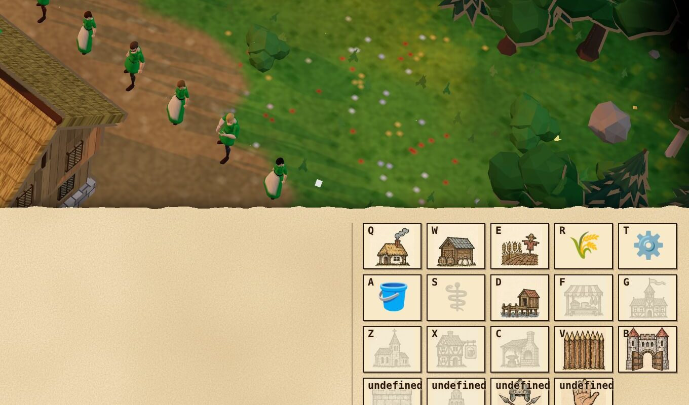

Select a villager in a town visit (or in a skirmish) and the settlement page of the build menu has 19 buttons for 15 places.
The last row has no hotkeys, reads "undefined" on each button, and is cut off by the bottom of the screen. The Granary,
Mill, Well and Infirmary were added after the Farm (`src/sim/data.ts:792`), which pushed the Gate onto **B**, the key that
used to turn the page to the military buildings; the page button is now the fourth "undefined" one, half off the screen, so
the barracks and the rest are hard to reach. The four new buildings also show as emoji (🌾 ⚙️ 🪣 ⚕️) beside drawn icons.
`SLOT_KEYS` and the card are in `src/client/hud.ts:38, 455`.

### 2. A field battle and a town visit open with the skirmish's rules (high)

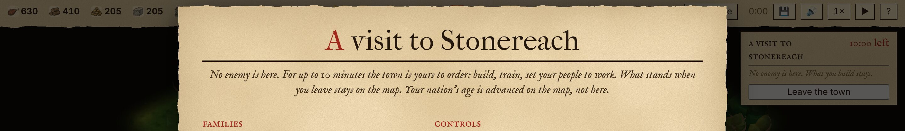

Both open on the full skirmish briefing. The field battle says "There is nothing to build: destroy every enemy soldier", and
under it *Families* tells the player to train villagers at the Town Center and build Houses, and *Goal* says "Advance
through five ages and bring down your rivals' Town Centers." The visit says "No enemy is here" and "Your nation's age is
advanced on the map, not here", and then the same *Goal*. A player reads the two against each other.

### 3. The Victory card has an empty box in the middle (medium)

After a field battle of 23 seconds the chart in the Victory card is an empty frame, and the table under it is all noughts but
the kills (Gathered, Born, Trained, Razed: none of which a field battle has). "Your enemy lies in ruins. Your people will tell
this story for ages" is said of four men of a local tribe.

### 4. "First Orders" sits on top of every window, and stalls on step 2 (medium)

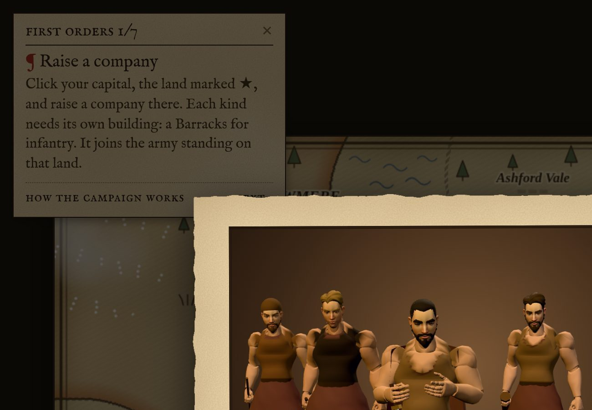

The First Orders box is drawn above the encounter window and the tale dialogs, cutting across their corner. In the Franks'
campaign it stayed on *2/7 Build on your land* from season 3 to season 13 while the player raised a Granary, a Mill and a
Well and learned a study: step 2 counts only the land's sites, Farmland and Barracks and the like (`src/sim/primer.ts:36`),
not the town's buildings, which are the ones the panel calls "Raise". Its last step, "Take every land", is not the game
`docs/DESIGN.md` describes.

### 5. "the Kushites's" (low)

"The people of Gullhaven now count themselves the Kushites's." Every people's name already ends in *s* and begins with
*the*: `src/sim/conquered.ts:116` adds *'s* to it. Seen three times in the Japanese campaign ("the Malians's" too).

### 6. The page died after 13 seasons, once (low, not reproduced)

In the first Franks' run the page closed itself after season 13 (Playwright: "Target page, context or browser has been
closed"). Two later runs of 20 seasons with the heap measured each season did not do it. Worth a look only if a player
reports it.

## What's confusing

### 7. Two kinds of building in one list, with different words and different money (high)

Under *Build* the panel mixes three things: "Raise Granary", "Raise Watch House" (a town building, no price shown, paid from
the town's stores, built by its governor over a season or two); "Study Crop Rotation"; and "Build Archery Range 5", "Build
Church 5" (a site of the land, paid in supplies, one of a few the land can hold). Nothing tells the player why there are two
words, two purses, and two limits. Locked ones are greyed with only a tooltip to say why ("needs the nation in a later age").

### 8. The player's own colour can hardly be read, and rivals share colours (medium)

Playing the Japanese, "Japanese (you)" and "You" on the panel are a pale grey-lilac on parchment. Playing the Japanese
against the Franks and the Kushites, both rivals were green; playing the Franks, the Malians and the English were a brown
and a red hard to tell apart. On the 3D map the shields are the only mark of whose a land is, so two rivals in one colour read as one.

### 9. A Japanese town builds a Church, and decrees "Call them to church" (medium)

The building list and the decrees name the Church and show ⛪ whatever the people (see shot 7). The model on the map already
wears the people's own sign (a torii, a crescent, a flame), so only the words lag behind. The owner asked for it to feel
real; this is where it doesn't.

### 10. The tales come every fourth season, with three tall buttons in capitals (medium)

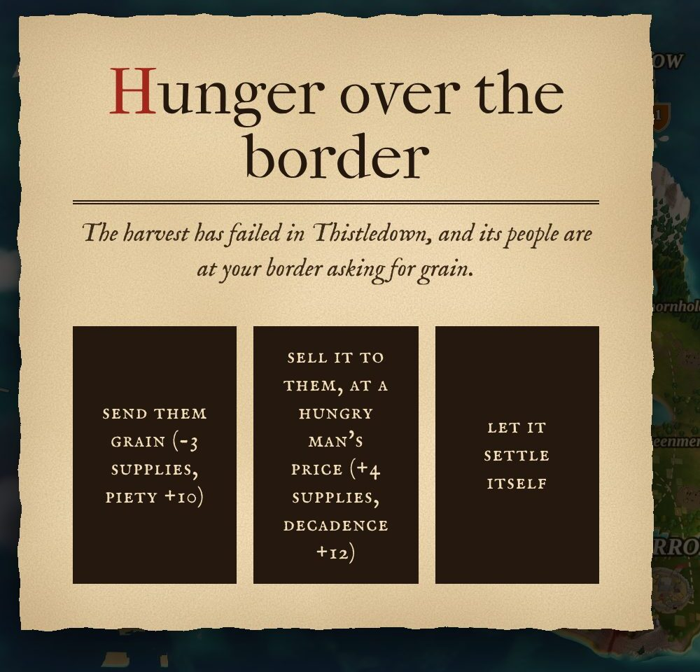

In both campaigns a tale came on seasons 3, 7, 11, 15 and 19, like a clock. Each is a dialog of three narrow buttons with the
whole price in small capitals ("SELL IT TO THEM, AT A HUNGRY MAN'S PRICE (+4 SUPPLIES, DECADENCE +12)"), hard to read
and harder to compare; *Let it settle itself* never says what it does. The stories met face to face (shot 12) read far better.

### 11. "of age in 43" (low)

"Heirs: Ada (of age), Brea (of age in 55), Ivo (of age in 60)." The number is seasons from now, but reads as an age.

### 12. Small numbers that read as nonsense (low)

"Raiders, the Ash Riders, came against Riverbend with a strength of 0.9 … the town defended itself with its men (0.9), its
fortress and barracks (0.5), the army there (11), the capital's guard (1): 13.4 in all." Strengths with tenths, and a band of
0.9 called raiders.

## What's never seen

Over 40 seasons in two campaigns, played the way a new player would (one land, building and decreeing):

### 13. The encounter window never opened by itself (high)

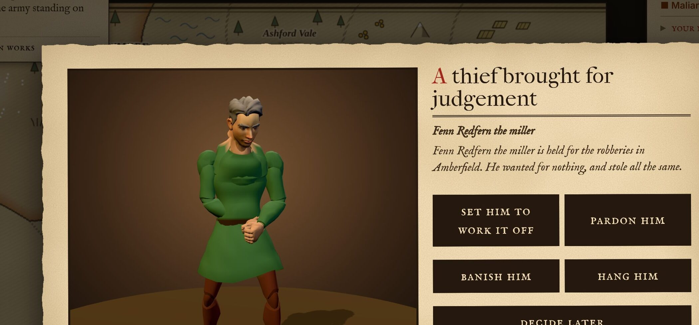

The four stories met face to face need a thief **caught** (a watch set, or many seasons), a **grown** daughter (the heirs
come of age in 40 to 60 seasons), a spouse and a rival who hates the player, or nobles angry enough to plot. None of that
happened in 40 seasons. A band is met face to face only when the player sends an army at it from the band's own land; the
bands that came against the player's towns (six times) were settled on the map without a window. So the system the owner
asked for on 16 November is, for most players, never seen in their first hours. It works when it comes: every story's window
answered rightly (thief set to work, suitor wed, envoy defied, plotter pardoned), with no errors.

### 14. Most of the new town buildings and the studies stay locked for a passive player (medium)

The Infirmary, Hall of Judgement, Noble's Manor, Monastery, Watch House and Inn, and every study, ask for a later age. The
Japanese player who raised a company each season never saved the 20 supplies for the Bronze Age and saw none of them in 20
seasons. The Franks' player who saved for it reached the Bronze Age in season 6 and then raised the Infirmary (season 9),
the Watch House (10), the Inn (11) and the Hall of Judgement (12), and learned Kinship, Crop Rotation, Salting and Smoking and
Stewardship; the Noble's Manor, the Monastery and eleven studies were still locked in the Iron Age at season 20. Nothing on
the panel says *save for the age to open these*.

### 15. Convoys, roads, harbours, diplomacy, marriage (medium)

With one land there is no convoy button and no road; no rival offered or asked for a truce in 40 seasons; the harbour stayed a
button. Each is there, but only for a player who goes looking.

## What worked

- Buy grain abroad: given in eight seasons out of twenty (it can be given every other season), each time "50 food for 50 gold" into the town's stores, and the log
  says so.
- The Granary, Mill and Well rose over the next seasons, each with its own line in the log, from the town's own stores; for
  the Franks, after the Bronze Age, the Infirmary, Watch House, Inn and Hall of Judgement as well.
- Studies: four learned by the Franks, one a season, each from the panel.
- Advancing the age from the panel, twice (Bronze in season 6, Iron in season 19).
- A field battle in person, both nations: from the map to the battle and back, the land changing hands, the leader's word on
  the panel.
- A town visit, both nations: in, a villager chosen, out, back on the map.
- The thief, the suitor (including *Ask Elin what she wants*), the envoy and the plotter, each in its window, each answer
  carried out; the killer stayed on the land's panel with its accusations, as meant.
- The band's window, with its men and those it holds. One fix made here, in my own file: the third of the band's captives
  sat outside the right edge of the picture; `src/client/encounter.ts` now seats them further back and closer together, and
  all three show (shot 13, second picture).

## Fixed since

The fixes handed back to this session, each with a 2× screenshot:

- **1, the build menu** (`fixed-build-menu.jpg`): the villager's menu is in pages of at most 13 (Settlement 1 of 2,
  Settlement 2 of 2, Military), **V** turns the page and **B** is Stop, as on every unit's card; no key is ever printed as
  "undefined". The Granary, Mill, Well, Infirmary, Watch House, Fortress and Inn have drawn icons
  (`scripts/civic-icons.mjs`, which writes `public/assets/icons/*.svg`); a painted `.webp` of the same name replaces any.
- **4, First Orders** (`fixed-first-orders.jpg`, `fixed-band-strength.jpg`): hidden while a dialog, a meeting or the
  season's card is open; raising a town building counts as building on the land; the last step is *Outlast them*.
- **7, the panel's groups** (`fixed-panel-groups.jpg`): *Raise troops*, *Raise in this town* (with each price in the
  town's stores), *Study*, *Build on the land* (in supplies, with how many sites stand), each under a line saying who pays.
- **8, colours** (`fixed-colours.jpg`): the Japanese wear indigo; no two peoples of one world wear colours too alike
  (`src/sim/nationcolours.ts`). Campaigns begun before this keep the colours they were dealt.
- **9, the house of faith** (`fixed-decrees.jpg`): a Shrine, a Mosque, a Temple, a Fire Temple or a Church by the people's
  sign, in the panel and the decrees (`src/sim/faithhouse.ts`).
- **11, heirs** (`fixed-heirs.jpg`): "of age in 2 years".
- **12, strengths** (`fixed-band-strength.jpg`): "a strength of 5 (strong)"; a raid's report gives whole numbers and says
  "about" when the rounded parts would not add up.

# Second pass, 17 November 2026 (main at 0283c7a)

The same play as the first pass, on today's main: the Japanese and then the Franks for 20 seasons each, kept as dealt,
the driver answering what is put to it, raising the next town building, learning a study, giving decrees (Buy grain
abroad first), raising a company every fourth season and advancing the age when it can. In this pass it also sent
settlers whenever an empty land was offered, and made a deal with a noble every third season. A field battle in person and
a town visit for the Franks; an empty wild land beside the capital looked at and marched on; and, because neither campaign
ever offered settlers, a save with an empty land beside the capital, to send settlers there and see the town founded.

No errors reached the console in any of it. The page did not die in 40 seasons (the heap stayed at 47–89 MB).

## What the first pass found that is now right

- **The build menu** (finding 1): three pages, no "undefined", V and B in their places, also inside a town visit
  (`playtest2-build-menu.jpg`).
- **The battle's briefing and end card** (2, 3): a field battle says who you lead and against whom, what winning means and
  what follows; the card counts both sides, kind by kind, and names the fallen (`playtest2-briefing.jpg`,
  `playtest2-end-card.jpg`). The visit's own briefing says who lives there and that nothing is won or lost
  (`playtest2-visit.jpg`).
- **First Orders** (4): out of the way of every window met in 40 seasons.
- **"among the Kushites"** (5): "The people of Thistledown now count themselves among the English."
- **The tales** (10): seasons 5, 9, 13, 16, 19 and 21 for the Japanese; 4, 8, 12, 16, 18, 20 for the Franks. No longer
  a clock. Each answer in plain case with its price beneath, and *Let it settle itself* says what it does.
- **Met face to face** (13): a rival's envoy came for the Japanese in season 8, a suitor for the Franks' daughter in
  season 14, both by themselves.
- **What the next age opens** (14): the panel names the buildings and studies and what to save
  (`playtest2-next-age.jpg`). The Franks saved and advanced twice; the Japanese once.
- **Buy grain abroad**: given seven times by the Japanese and five by the Franks, each time "50 food for 50 gold".
- **The colours and the house of faith** (8, 9): the Japanese in indigo, a Shrine, "Call them to the shrine".

## What's broken

### 2.1 A story's window opens on top of the season's card (medium)

When a story comes to the leader's word in a season that also has news, the encounter window and the season's card are open
together, the card's first lines showing above the window. One should wait for the other.

### 2.2 True wilderness reads as a tribe's land you can march on (medium)

Gullhaven, near the Franks' capital in a new world, is the frozen north: nobody can settle it or take it. Its panel says "Local Tribe,
Income 1 · Defence 2, 0 bands of local warriors, Select one of your armies to march on this land". Marching the army
there does nothing, and nothing says why. It should say it is wilderness, and what that means.

### 2.3 The settlers' button names source files (low)

Its tooltip: "… to found a town on an empty land beside your own (migration.ts, founding.ts). They are not one of your
convoys." (`src/client/convoypanel.ts:12`).

### 2.4 The end card names a tribe's fallen as the player's own people (low)

"Of theirs: Dunn, Wend, Marn, Marn, Marn, Corin, Joss, Dunn." Three Marns and two Dunns among eight men of a local tribe,
with the names of the player's own towns.

## What's confusing

### 2.5 A town is founded without a word (medium)

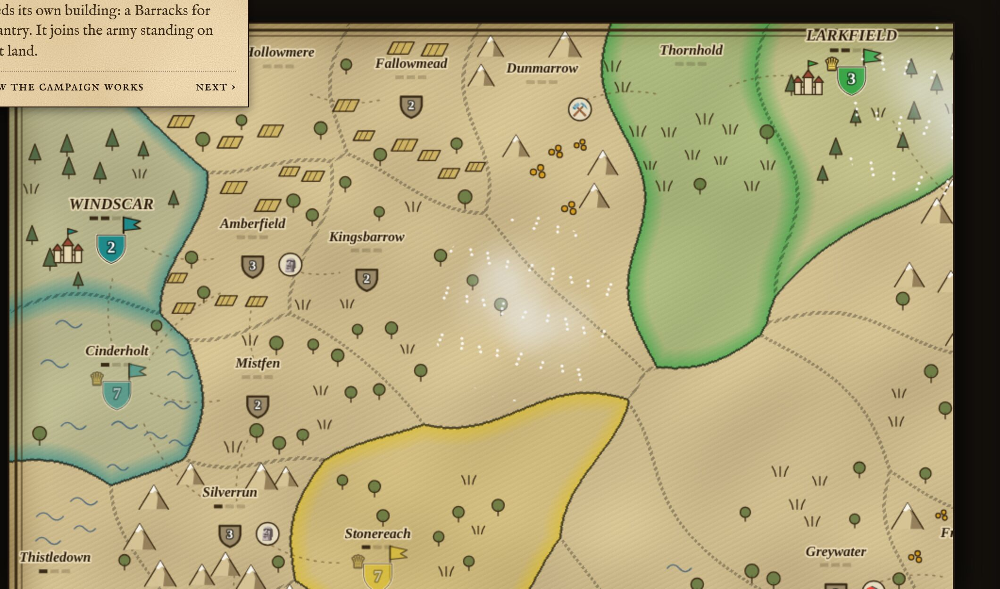

Settlers sent from Larkfield ("7 settlers have set out … they will be there next season") arrived and made Thornhold the
player's, but the season's card and the log said nothing of it; it is in the chronicle only. The first the player hears is
"Food is short at Thornhold: the governor has sent more of its people to the fields."

### 2.6 Dealing with nobles is a wall of buttons (medium)

Each noble outside the leader's circle gets five buttons under *Town*: two nobles make ten, between the convoys and the
decrees. *Strip of their lands* (fear, anger, 150 gold seized) is one click beside *Send a gift*, with no asking. A captain
is offered "Make Captain of the host". The deals say what they cost but not what they do: after a gift the only word is
"Gifts are sent to Captain Osric of Larkfield", and the change shows only as *content* turning *pleased* in the Nobles line.

### 2.7 The tales' answers stand in tall narrow columns (low)

The plain case reads far better than before, but the three answers stand side by side in narrow boxes: *Let it settle
itself* and its explanation run to seven lines. One answer to a row would read at a glance.

### 2.8 A field battle still shows the town's bar (low)

The top bar of a field battle shows food, wood, gold and stone and a red "8/0" for people, where the briefing says nothing is
gathered or built (`playtest2-end-card.jpg`, top left).

## What's never seen

### 2.9 Settlers and founding (high)

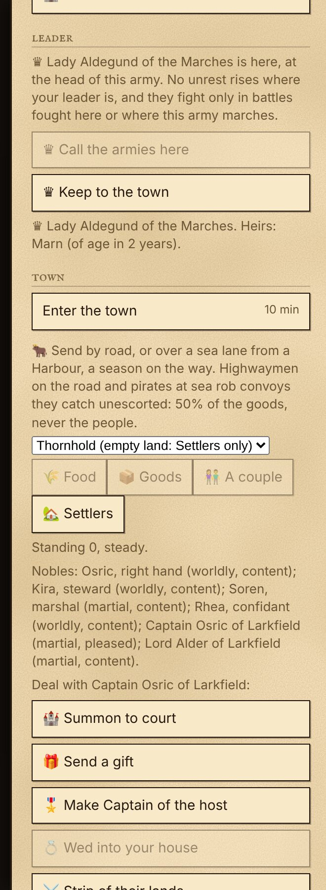

In 40 seasons neither the Japanese nor the Franks were ever offered settlers: no land beside a one-land people was empty
and settleable (the convoy part of the panel, where settlers are sent, never appeared in either capital; the one empty land
looked at near a capital was true wilderness). From a save with an empty land
beside the capital it all works: the land is offered as "Thornhold (empty land: Settlers only)", the settlers set out with
food and timber, the land is the player's the next season with the seven of them, and its town is laid the season after.
A player who never takes land will not meet it; one who does may, when a tribe dies out. Nothing tells them it exists.

### 2.10 Nobles to deal with, for a small nation (medium)

The Japanese had nobles listed all 20 seasons (the right hand, the steward, the marshal, the confidant), and no deal with
any of them was ever offered: deals are only with captains, matrons and lords, and the Japanese capital never had a veteran,
a mother of note or twelve grown people at once. The Franks had a lord from season 3 and a captain from season 9, and the
deals worked (summoned three times, two gifts). For the Japanese the Nobles line is a list with nothing to do.

### 2.11 Bands that march on the player, face to face (medium)

Slavers came against both capitals (the Iron Market at Gullhaven; the Iron Market and the Tally-keepers at Dunmarrow) and
were beaten back, each settled on the map with a line in the log and no window. None was seen coming: the "seen on the
march" lines were all other peoples' ("The people at Windscar have seen the Tally-keepers on the march"), and no band fell
on the player's army. The encounter window opens only when the player sends an army at a band, or a band falls on one of
their armies; the threats session's change for a band coming for a town (4400e4b) reached main after this pass began.

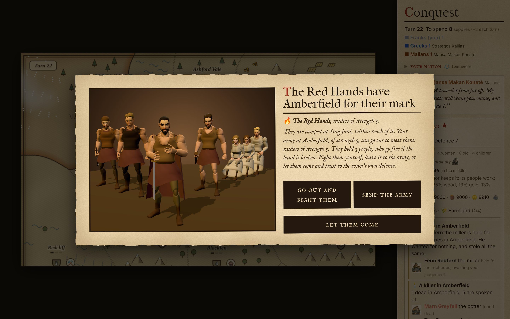

Tried afterwards on today's main, from the save with a raiding band beside the army: once the four stories were put aside,
"The Red Hands have Amberfield for their mark" opened by itself, with the band's men and its captives, and three answers
(go out and fight them, send the army, let them come). It reads well. Two small things: it gives the strength as a bare
number ("raiders of strength 5") where the other band windows now say "a strength of 5 (strong)", and it gives the band's
strength twice in four lines.

### 2.12 Migration (low)

No family moved of its own accord, as expected: with one town there is nowhere of their own people to go.

## Fixed since the second pass

- **2.1, a story's window over the season's card** (`fixed2-card-first.jpg`, `fixed2-then-envoy.jpg`): the card comes
  first; a meeting face to face, or a band coming, waits behind it and opens when the card is closed (or, if the player
  looks back over past seasons from it, when that is closed).
- **2.7, the tale's answers** (`fixed2-tale.jpg`): one answer to a row, its price at the right; the longest, *Let it settle
  itself* and what it means, reads in two lines.
- **2.8, a field battle's bar** (`fixed2-field-bar.jpg`): it counts the two sides still standing ("Yours 7 · Theirs 4")
  instead of the town's stores and people, and there is no idle-villager button. A siege or a visit keeps the town's bar.
- **A raid told twice** (follow-up, `fixed3-strike-first.jpg`, `fixed3-card-folds.jpg`): a band that got into a town of
  the player's this season is told face to face first; the season's card waits for that window to close, then gives
  those raids one line ("The raid on your towns, as you were told when the season turned"), keeping a raid beaten off as
  it was (`foldTold`, src/client/seasoncard.ts). The card also waits for any other meeting face to face that is open.

# Third pass, 17 November 2026 (main at d575557)

The same play again on today's main: the Japanese and then the Franks for 20 seasons each, the driver now also dealing with
a noble every third season through the new dialog (a gift each time) and answering a band coming with *Send the army*; a
field battle and a town visit; the panels of empty and wild lands looked at in freshly dealt worlds; and two saves made by
hand for what did not come by itself: a raid that gets into the capital (for the strike report and the card's folding), and
an empty land two lands out (for settlers going further and the founding news). No errors reached the console in any of
it; the heap stayed at 55–91 MB.

## What is now right

- **The strike report and the card** (`playtest3-strike.jpg`, `playtest3-card-fold.jpg`, from the hand-made save): the raid
  is told first, face to face, with the band, what was taken and who was carried off by name; after *So be it* the
  season's card gives it one line and keeps the raid beaten off as it was.
- **A band coming, by itself** (`playtest3-band-coming.jpg`): in season 20 of the Japanese campaign, after "Your people at
  Stonereach have seen the Ash Riders on the march", the window opened on its own: "The Ash Riders have Stonereach for
  their mark", the army's and the band's strength in the same words ("9 (very strong)", "1 (weak)").
- **Nobles to deal with, by themselves**: both capitals had their lord from the first seasons (the Japanese lord began at
  mood −18 and four gifts brought him to 91), and a captain came later in each (seasons 18 and 15).
- **The noble's dialog** (`playtest3-deal.jpg`, `playtest3-strip.jpg`): one *Deal with …* button; the dialog gives each
  dealing its price and what it does in words, says why one cannot be done, and asks again before stripping a noble.
  A gift now says what it did ("his mood rises by 20, and he will think the better of you for two years").
- **Wilderness and empty land** (`playtest3-wilderness.jpg`): a wild land names itself and says it cannot be settled or
  taken, and an army can no longer be sent at it; an empty land says settlers may found a town there.
- **Settlers going further, and told** (`playtest3-settlers-far.jpg`, `playtest3-founded-card.jpg`): the capital offers
  empty lands with how far ("a season away", "2 seasons away"); settlers sent two lands out arrived in two seasons, and the
  log and the season's card both said "Settlers from Sunfields have founded Amberfield".
- **The field battle's bar and end card** (`playtest3-field-bar.jpg`, `playtest3-end-card.jpg`): "Yours 7 · Theirs 4";
  the tribe's fallen have names of their own ("Zeb, Erl, Nar, Wulk").
- **Face to face, again by itself**: a rival's envoy in season 12 (Japanese) and season 8 (Franks).

## What's broken

### 3.1 An empty land promises settlers it is too far for (medium)

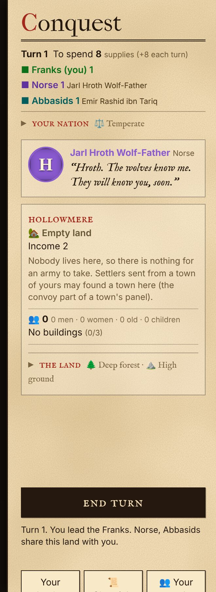

Hollowmere, four lands from the capital through tribes' lands, says "Settlers sent from a town of yours may found a town
here (the convoy part of a town's panel)". The capital does not offer it (settleBar: "too far: settlers cross at most 2
lands with nobody on them"). In one freshly dealt world the same happened beside the start: Eastmarch, near the Franks'
capital, said the same while the capital had no convoy part at all. The panel should say whether a town of yours can reach
it, and if not, why.

### 3.2 The season's card tells a founding twice, with the wrong signs (low)

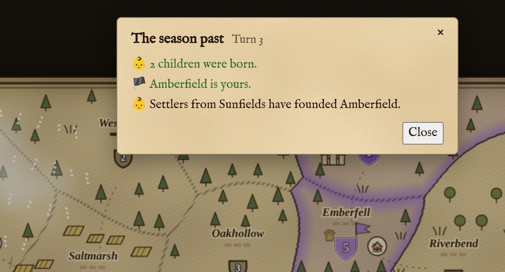

"🏴 Amberfield is yours." (the flag of a land won) and then "👶 Settlers from Sunfields have founded Amberfield." (the sign
for a birth). One line, with the settlers' 🏡, would do.

### 3.3 Small words in the noble's dialog (low)

The dialog opens "Mood 0. Not now: wed into your house (Your house has no grown son or daughter to wed them.)", and its last
button is also *Not now*; the opening line reads as if it were one of the answers. Stripping asks "Strip Lord Osric of
Sunfields of **their** lands?" where everything else says *he*, and its first line ("The nobles' fear and anger; 150 gold
seized.") is said again in the next.

### 3.4 "Lady Aldegund of the Marches's head" (low)

A rival king's threat: "he will have Lady Aldegund of the Marches's head" (`src/sim/courtstory.ts:113`); and "a man with a
knife was taken at Lady Aldegund of the Marches's door". A title with "of" takes its 's badly; "the head of Lady Aldegund
of the Marches" reads right.

### 3.5 The settlers' destination box is cut off (low)

The list's box is narrower than its words: "Whitepeak (empty land: Settlers only, a seas…" (`playtest3-settlers-far.jpg`).

### 3.6 Wilderness has an income (low)

A wild land's panel says "Income 1" under "Wilderness … It cannot be settled or taken" (`playtest3-wilderness.jpg`).

## What's never seen

### 3.7 Settlers, in play (high)

Still never offered in 40 seasons: neither capital ever had an empty, settleable land in reach. In about ten worlds dealt
fresh for the Franks and looked over at the start, none offered settlers from the capital: six had no empty land beside
it, and the two that had empty lands further off (Eastmarch in one; Amberfield and Silverrun in another) had no convoy part
in the capital's panel. It all works from a save (above). A player meets it only if a tribe dies out near them.

### 3.8 The strike report, in play (medium)

Bands came against the capitals and were beaten back every time in 40 seasons; none got in, so the strike report never
opened by itself. (Before the fixes, 39 computer-run campaigns of 60 seasons had none either.) It is seen from the
hand-made save only.

### 3.9 The Franks never reached the Bronze Age (medium, for tuning)

The Franks' supplies stayed between 4 and 16 from season 5 to season 20, so the 20 for the Bronze Age never came, and
with it none of the later town buildings or studies. The driver spent 2 on a gift every third season, 2 on a company every
fourth, and gave decrees. The Japanese reached it in season 14; in the second pass the Franks did in season 6 and the
Japanese in season 10. A player who answers the nobles and keeps an army may now wait a long time for the next age.

# Fourth pass, 17 November 2026 (main at d318614)

A pass on what landed today: towns four times the size, the field's cap of forty, the first lay of a town and the
buildings it cannot place, the militia, a man home on leave, men left queued, and the batched figures. Played by the armies
session in Chromium (Playwright, 1440 × 900) from a clean browser: the Franks, "Keep the world as dealt", twelve seasons.

- **Twelve seasons on the map**, answering what was put (a band coming: *Let them come*; three matters brought before the
  leader; the season's card each turn), raising a company in the first season.
- **A visit to the capital** in season 9, the first time anybody had been in it: a soldier sent home and called back,
  another sent home and left there, three men put to training at the barracks, *Leave the town* with two still in the queue.
  Then three more seasons, and a second visit.
- **A siege attacked**: the army marched on the tribe's town next door (Kingsbarrow), *Siege battle*, fought to the end.
- **A battle defended twice**, from a save made by hand (a rival's army set on the land next door and marched on the
  capital): once as a *Field battle*, once as a *Siege battle* with a man sent home in the middle of it.

The battle's and the visit's clocks were stepped from the script, the app's own way (the rivals' minds turned every
second), because the headless browser draws a few frames a second; so nothing here says whether the batched figures made
the field faster on a real machine. No error reached the console in any of it: no page error, no failed load.

Ranked as before. The pictures are 2× in `docs/shots/playtest4-*.jpg`.

## What is now right

- **The first lay.** The capital had never been entered: 67 people, 23 buildings on a coarse record. The visit's briefing
  said "28 Villagers and 6 Clubmen", which is the map's 11 men and 17 women and its three companies, and the town stood
  whole: the hall, the barracks, the farm, the well, mill and granary the governor had raised, and all 17 houses, around
  the hall on free ground (`playtest4-visit-idle.jpg`). The children were on the houses' records. After the visit the
  record was a real one of the same 23 buildings; three seasons later the governor's new house stood with them.
  Nothing was left without a place in any sitting.
- **A man home on leave.** *Go home* on a soldier of the army: "Perrin Oakes" walked to an empty house and its card said
  "Lives in a house"; *Take up arms* put his company back and freed the house. The next man asked was Tam Oakes, left at
  home: on the map the army was a company the fewer, the roll a man shorter, the town a man the more, and the chronicle
  said so. The same in the middle of the siege defended.
- **Men left queued.** Two men still in the barracks' queue on leaving were kept by name; the next season "Ned of
  Harrowdale, who was training as a clubman when you left, has taken the field: a company of infantry joins the army
  there", and the same for Joss; the town's men fell by two and the roll grew by two.
- **The siege defended.** The town came to the field as it stood after the visit (18 houses, the works), with 27 of its 29
  grown and two of its men in arms beside the army's four companies. The end card's tally (11 began, 4 fell) and the map
  (the army two companies the fewer, one of them the man who went home) agree.
- **A band against the town.** "The town defended itself with its men (1), its fortress and barracks (1), the army there
  (5), the capital's guard (1): 8 in all", and the panel keeps "Against a band this town can muster 7.7".

## What's broken

### 4.1 Taking a tribe's town in person kills everyone in it (high)

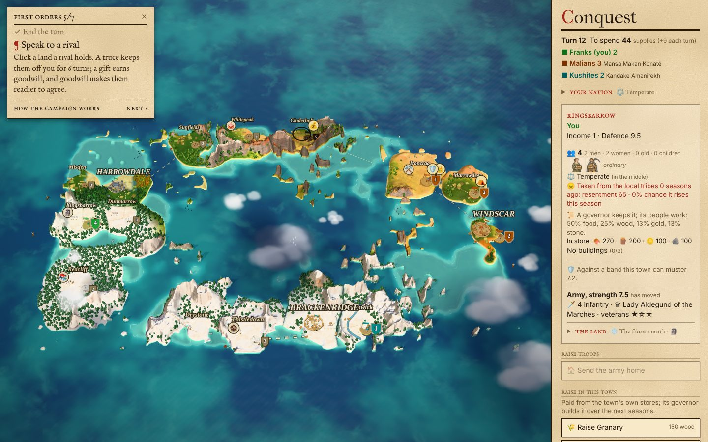

Kingsbarrow had 67 people on the map (15 men, 14 women, 4 old, 34 children). In the siege the "Local Tribe" stood on the
field as eight clubmen and one villager with **no building at all**, though the briefing says "Bring down their Town
Center". The eight fell in 78 seconds and the battle was won. On the map: "You took Kingsbarrow from the locals. Of your
people at Kingsbarrow, 67 died: 0 remain. Nobody was left alive in Kingsbarrow. Four who followed the army have settled
there."

Why (rebuilt headless from the same save): the battle is handed the town's people (`people: {men: 15, women: 14, …}`), but
this tribe's people are of a raiding kind (`steppe`), and `game.ts` begins a raiding side as a war band: a man, a woman and
seven fighters, no hall, and `peopled` is never called. The count written back after the battle is of that field, so the
67 who were never on it are written off as dead. Any tribe (or rival) of a raiding people is the same. A field battle
there is not: it only takes the men who march out.

Not the armies session's: the war band's start is the marauders' (threats session), the count written back is
township's (people session).

### 4.2 After a battle for a town, one man's work is the whole town's orders (high)

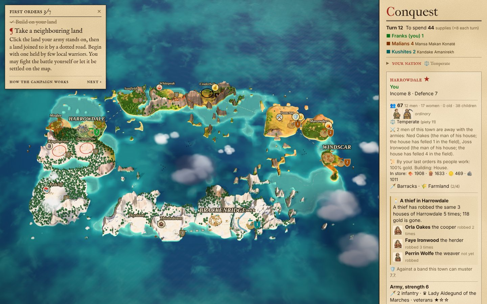

Before the siege the capital read "A governor keeps it; its people work: 50% food, 25% wood, 13% gold, 13% stone". In the
battle its 27 townsfolk stood idle and one man (the soldier sent home) dug gold. Afterwards: "By your last orders its
people work: 100% gold. Building: House." A town of 67 now digs nothing but gold until the player visits it again, on
orders the player never gave. After a visit in which nobody was set to work the governor's shares were kept, which is
right; here one worker out of 28 was taken for the whole town.

Not the armies session's: the orders written back from a field (`Game.orders`, `townorders`/`governor`, people session).

### 4.3 Nobody lives in the town's houses (high)

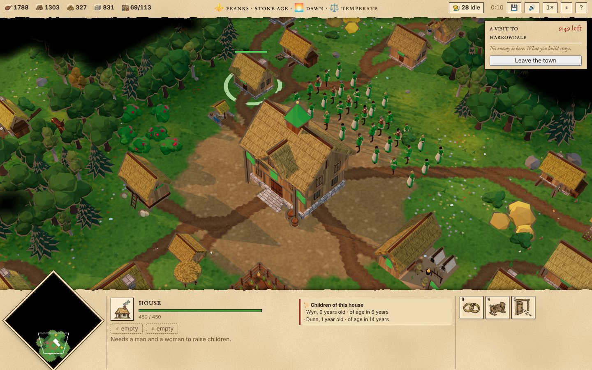

Every sitting in the capital began the same way, the first visit, the second, and the siege: all 17 (then 18) houses
"♂ empty ♀ empty · Needs a man and a woman to raise children", every one of the 28 grown standing in a crowd by the hall,
homeless and idle ("28 idle"), with the children on the houses' records. Nothing moves them in: after 90 seconds they
were as they began. Who lives where is not kept from one sitting to the next either: Tam Oakes, who went home on leave
and was "living under a roof of his own", was homeless again at the next visit.

It was always so for a town's own people, but until today a town nobody had built in had no houses to be empty; with
the first lay a player's first sight of their capital is forty roofs and nobody under them. It also means no house on
the field has a family's name, so a man home on leave is never found his own door (see 4.5).

Not the armies session's alone: the first lay is the portrait session's, who lives where is township's and
`household.ts` (people session). The houses could be filled as the town is peopled (couples as the map counts them),
and the people set to the governor's shares.

### 4.4 A man trained in a visit made no company (medium, fixed in this pass)

Three men were sent to the barracks. Two were still in its queue on leaving, and each became a company next season. The
third finished his training in the town, and came to nothing: the army did not grow, and he was counted a townsman again.
A visit counted the field's two soldiers to a company, so a lone trained man was half of one; since towns grew, the map
musters one man to a company. `visit.ts` now counts a company for every `MEN.company` men trained (one, at the present
size), as for a queued man. `tests/trainedman.test.ts`.

### 4.5 "under a roof of his own, his old one gone" (low, fixed in this pass)

The chronicle said this of every man who went home, because no house on the field has his family's name (4.3), and "his
old one gone" was never true. It now says "under a roof of his own". The house of his record will be found once houses
on the field carry their families.

## What's confusing

### 4.6 "+8 each turn" is not what is gained (medium)

The bar reads "To spend 8 supplies (+8 each turn)" from the first season to the twelfth. What there was to spend went 8,
11, 15, 17, 21, 19, 29, 33, 36, … 44: three or four a season, once down by two. Supplies are counted from what the towns
hold above their working stock, so the town's eating, the governor's building out of the stores and a failed harvest all
come out of it; the "+8" is none of those. Either the figure should be what the last season in fact added, or it should
say what it is. (Food and stores session.)

### 4.7 Three figures for one town's defence, two for one band (medium)

In one season the capital's panel said "Defence 6", "Against a band this town can muster 7.7", and of the raid just
past "8 in all"; the band was "a strength of 3 (middling)" in the window that asked what to do and "a strength of 2
(middling)" in the report. Each is right by its own rule, and a player cannot tell which to plan by. (Threats session,
with the militia's share from the armies session: the panel's "Defence" is against an army, the other two against a
band; saying so on the first line would do.)

### 4.8 The season's card, in small (low)

- "✝ 1 man was killed in battle" in a season with no battle: it was the company the plague took from the army.
- "Of your people at Harrowdale, 1 more were born or came of age: 64 remain" after the visit: the one more was the
  soldier who came home, and "1 more were".
- The same season: 4 dead of plague (all four of the town's old), 4 men killed beating off a band of strength 2 with a
  defence of 8, a company lost to plague: 9 dead of 61 in a season the town "held off" a raid. For the threats session's
  tuning at the new size rather than a fault.

*Fixed after the pass (the first two):* the report now says "1 man died with the army", true of a battle and of a
plague in the army's camp alike (armytown.ts counts both); and a town's count after a sitting says "1 more was born,
came of age or came home". The third is left to the threats session's tuning.

### 4.9 The names of the fallen (low)

The end card names them from the field ("Fell by name, of yours: Kell, Fenn"; "Holt"); the map then says "1 man of
Harrowdale fell with the army. He was Marn Ironwood." And a man on the roll changed his name between seasons: "Ned Oakes
(the man of his house)" before the defence, "Edric Oakes" after it, when a clubman called Edric was acclaimed on the
field. Which soldier is which man is still not kept (the board's gap under *Home on leave*).

*Fixed after the pass (soldiernames.ts):* each company of an army is led on the field by the man of its roll, by his
name and house; the men whose soldiers went down are the ones the map counts lost, first, dead or home hurt; and the
man of a house keeps his name when a soldier is acclaimed or makes his name on the field.

### 4.10 Small words (low)

"Malians marches with a strength of 5.4"; "Malians attacked Harrowdale and was thrown back"; the end card of a siege
held: "A battle won at the cost of 4 men: the town is taken or held"; of the tribe's eight: "A skirmish won at the cost
of 1 man".

*Fixed after the pass:* a people's name is plural, so "Malians march" and "attacked Harrowdale and were thrown back"
(the local tribe, the one singular name, still "marches"); and the end card of a fight for a town says what became of
the town, whatever its size: "The town has held at the cost of 4 men", "The town is taken at the cost of 1 man", "The
town has fallen", "The assault has failed" (battlecard.ts verdictOf, told by briefing.ts which side came to take it).

## What's never seen

- **The field's cap.** No town of the player's passed forty grown in twelve seasons (the capital had 29), so nobody was
  held back from a field.
- **A building with no place.** Every building found room in every sitting.
- **A man's own door.** No house on the field has a family (4.3), so only "a roof of his own" was seen.
- **Whether the field is faster.** A headless browser cannot say; it wants a real machine.

## Fixed since the fourth pass

- **4.2 One man's work as the town's orders** (`src/sim/givenorders.ts`): the field now says how many hands the town
  had there, and the work it reports is orders only when half of them were at it. One man digging gold among
  twenty-seven idle leaves the town with the work it was last given, or its governor's shares; what stood half built
  and who was in the queues are kept as before.
- **4.3 Nobody lives in the houses** (`src/sim/roofs.ts`, `src/sim/roofsmap.ts`): a town comes to the field with its
  households seated. The couples the map counts married have a house each, a man and a woman; the wife of a man away
  with the armies is alone under his family's roof, so *Go home* sends him to his own door; and who lived where as
  the sitting ends is on the town's record, and they are under the same roofs by the same names next time, a season
  older for each season between. Still so: those with no roof (the unmarried, or more couples than houses) are homeless as before.
- **4.3, the idle crowd** (`src/sim/atwork.ts`): the town is at work as the sitting begins. Its people are set to
  food, wood, gold and stone by the shares it works by on the map (its last orders, or its governor's), each to the
  nearest of its kind, in a visit and in a siege defended; a side the computer plays sets its own. Leaving without
  changing anybody's work leaves the town's orders as they were.
- **4.4 and 4.5** were fixed in the pass itself.

## The new pieces together (after the fixes, main at d5996fc)

One short visit to the capital and one siege defended there, from the same save, to see the town at work, the
households, the soldiers' names and a man home on leave in one sitting. No error reached the console.

Right, together:

- **The visit.** "0 idle" from the first second: 29 villagers at food 7, wood 11, gold 6, stone 5 (the governor's
  shares with a full granary), and the stores rising. Fourteen households under their roofs: twelve couples, and
  "Oakes" and "Ironwood" with a wife alone, their men with the army. A soldier sent home was "Perrin Oakes" and walked
  to the Oakes house. On leaving, the orders were untouched ("A governor keeps it"), 14 households were on the record,
  and the chronicle said "is home, under his own roof again".
- **The siege.** The town came with ten houses full, the two wives alone, 27 at work, and the army's companies led by
  the men of its roll by name ("Marn Ironwood", "Perrin Oakes", "Joss Ironwood", "Ned Oakes"), each with a nameless
  follower. "Marn Ironwood" sent home in the fight was written on the map as "a son of his house again". The panel now
  reads "Defence against an army", and the reports "Malians march", "were thrown back".
- **4.1 on the Kingsbarrow save**, replayed headless on the fixed code: the tribe stands as a town (a hall, 31
  villagers, two men in arms), and storming it reads "2 died: 65 remain" where it read 67 dead.

Off:

- **A son took his father's place** (medium, fixed here): in the visit Perrin Oakes, "a son of the house" on the map,
  came home to the Oakes house and was seated as its man beside the wife of Ned Oakes, who is the man of that house and
  away himself. The field did not know which he was. The map now hands each man's tie to the field
  (`AwayMan.tie`), and a son never takes the man's place: he is of the house as its son (`leavehome.ts`).
- **The fallen by name, and the map** (medium, for the soldier-names work): the end card said "Fell by name, of
  yours: Fenn, Perrin Oakes, Holt, Ned Oakes, Joss Ironwood". The map then said "1 man of Harrowdale fell with the
  army; 1 came home hurt or routed. He was Ned Oakes", and Joss Ironwood is still on the army's roll and in its last
  company. The names now agree for the one the map lets fall; the others the field saw die are alive on the map.
  *Fixed after the pass (downedmap.ts):* once a battle fought in person is reckoned, every man the field saw fall who is
  still on his army's roll is taken off it as fallen, his house's loss, and his broken company struck from the army
  (never its last); those the reckoning sent home hurt stay home hurt.
- **A visit's soldiers have no names** (low): the roll is handed to a battle and not to a visit, so *Go home* there
  still takes the next man on the list.
  *Fixed after the pass:* a visit is handed the roll as a battle is (visit.ts), so its companies are led by their men
  by name and *Go home* takes the man whose name the soldier bears.
- **Shares in two voices** (low): the panel says "50% food, 25% wood, 13% gold, 13% stone" while the town in fact works
  25% food with a full granary (the governor's rule, `shareOf`); the field shows the second, the panel the first.
  Fixed (`src/sim/workwords.ts`): the panel now gives the shares the town works by this season, and says why where
  they are not the orders': "The granary is full, so he has taken hands from the fields for work that keeps", or
  "Food is short, so the governor has sent hands to the fields; your orders were …".
- **Namesakes** (low): in a town of thirty there were two Neds, two Josses, two Tesses and two Orlas among the
  villagers, beside the soldiers Ned Oakes and Joss Ironwood.
  *Fixed after the pass (namesakes.ts):* the lot draws a given name nobody of that people has, where one is left, and
  once the field is laid out a villager still under the lot's name who shares it, or a soldier's, is given a free one;
  a name from a record is never changed. The name lists are now sixty a sex (data.ts), so a town of a hundred seldom has any.

## Handed on

| What | Whose |
|---|---|
| 4.1 a raiding tribe's town defended as a war band, and its people written off | threats session (the war band's start), people session (the count written back) |
| 4.2 one worker's task written back as the town's orders | people session |
| 4.3 houses empty and everyone idle at every sitting; who lives where not kept | people session, portrait session (first lay) |
| 4.6 "+8 each turn" | food and stores session |
| 4.7 three figures for a town's defence | threats session |
| 4.8, 4.10 the card's and the reports' small words | fixed (the strength of 4.8's third line is for the threats session) |
| 4.9 which soldier is which man | fixed (soldiernames.ts) |
