# Playtest, 17 November 2026

Played in Chromium (Playwright, 1440 × 900), as a player would, from a clean browser each time:

- **Two campaigns of 20 seasons each:** the Japanese, then the Franks, both "Keep the world as dealt". Every season the player
  answered what was put to them, raised the next town building on offer, learned a study when one was open, gave decrees
  (Buy grain abroad first), raised a company now and then, and (the Franks) saved for the age and advanced it.
- **A battle fought in person** for each nation: an army marched on a neighbour, *Field battle*, *To battle*, the fight to the
  end, *Return to the map*. The soldiers were sent at the nearest foe with attack-move, and the battle's clock was stepped
  from the script, because the headless browser drew only a few frames a second.
- **A visit to a town** for each nation: *Enter the town*, a villager chosen, the build menu opened, *Leave the town*.
- **Every story that waits on the leader's word**, met face to face: a thief caught, a suitor, a rival king's envoy, a plotter
  found. None came up by itself in the 40 seasons (see *Never seen*), so a saved campaign was made with all four waiting, and
  a raiding band on the land next to the army, and loaded the way a saved game is.
- **A band met through the encounter window**, from that same save: *Send the army at … against the Red Hands*.

No errors reached the console in any of it: no page errors, no failed loads, across the two campaigns, both battles, both
visits and the stories. Once, playing the Franks for the first time, the page itself died after season 13 ("Target page
closed"); the JavaScript heap stayed flat at 50–80 MB in every later run, so it looks like the headless browser's graphics
memory rather than a leak in the game, but it is noted below in case a player sees it.

Each finding is ranked by how much a player would notice it: **high** is in front of them every time, **medium** is seen
once in a while or needs a second look, **low** is a detail. The pictures are 2× screenshots in `docs/shots/playtest-*.jpg`.

## What's broken

### 1. The villager's build menu runs off the screen, with four buttons named "undefined" (high)

Select a villager in a town visit (or in a skirmish) and the settlement page of the build menu has 19 buttons for 15 places.
The last row has no hotkeys, reads "undefined" on each button, and is cut off by the bottom of the screen. The Granary,
Mill, Well and Infirmary were added after the Farm (`src/sim/data.ts:792`), which pushed the Gate onto **B**, the key that
used to turn the page to the military buildings; the page button is now the fourth "undefined" one, half off the screen, so
the barracks and the rest are hard to reach. The four new buildings also show as emoji (🌾 ⚙️ 🪣 ⚕️) beside drawn icons.
`SLOT_KEYS` and the card are in `src/client/hud.ts:38, 455`.

### 2. A field battle and a town visit open with the skirmish's rules (high)

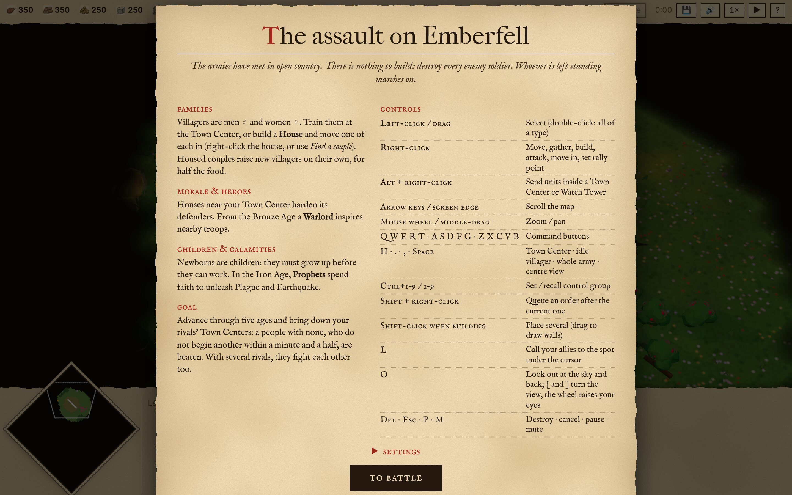

Both open on the full skirmish briefing. The field battle says "There is nothing to build: destroy every enemy soldier", and
under it *Families* tells the player to train villagers at the Town Center and build Houses, and *Goal* says "Advance
through five ages and bring down your rivals' Town Centers." The visit says "No enemy is here" and "Your nation's age is
advanced on the map, not here", and then the same *Goal*. A player reads the two against each other.

### 3. The Victory card has an empty box in the middle (medium)

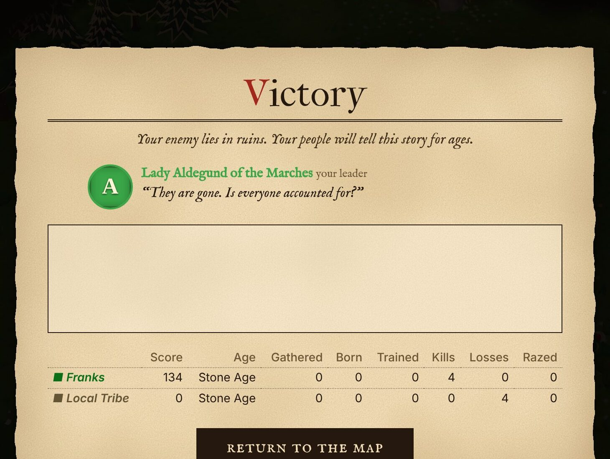

After a field battle of 23 seconds the chart in the Victory card is an empty frame, and the table under it is all noughts but
the kills (Gathered, Born, Trained, Razed: none of which a field battle has). "Your enemy lies in ruins. Your people will tell
this story for ages" is said of four men of a local tribe.

### 4. "First Orders" sits on top of every window, and stalls on step 2 (medium)

The First Orders box is drawn above the encounter window and the tale dialogs, cutting across their corner. In the Franks'
campaign it stayed on *2/7 Build on your land* from season 3 to season 13 while the player raised a Granary, a Mill and a
Well and learned a study: step 2 counts only the land's sites, Farmland and Barracks and the like (`src/sim/primer.ts:36`),
not the town's buildings, which are the ones the panel calls "Raise". Its last step, "Take every land", is not the game
`docs/DESIGN.md` describes.

### 5. "the Kushites's" (low)

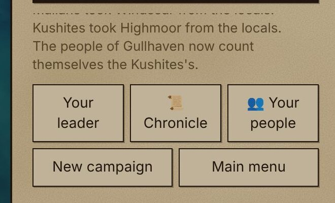

"The people of Gullhaven now count themselves the Kushites's." Every people's name already ends in *s* and begins with
*the*: `src/sim/conquered.ts:116` adds *'s* to it. Seen three times in the Japanese campaign ("the Malians's" too).

### 6. The page died after 13 seasons, once (low, not reproduced)

In the first Franks' run the page closed itself after season 13 (Playwright: "Target page, context or browser has been
closed"). Two later runs of 20 seasons with the heap measured each season did not do it. Worth a look only if a player
reports it.

## What's confusing

### 7. Two kinds of building in one list, with different words and different money (high)

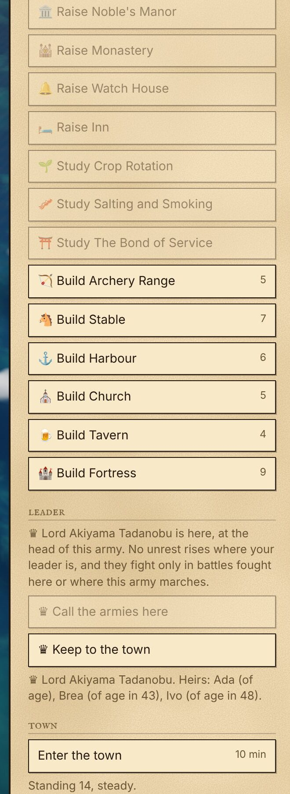

Under *Build* the panel mixes three things: "Raise Granary", "Raise Watch House" (a town building, no price shown, paid from
the town's stores, built by its governor over a season or two); "Study Crop Rotation"; and "Build Archery Range 5", "Build
Church 5" (a site of the land, paid in supplies, one of a few the land can hold). Nothing tells the player why there are two
words, two purses, and two limits. Locked ones are greyed with only a tooltip to say why ("needs the nation in a later age").

### 8. The player's own colour can hardly be read, and rivals share colours (medium)

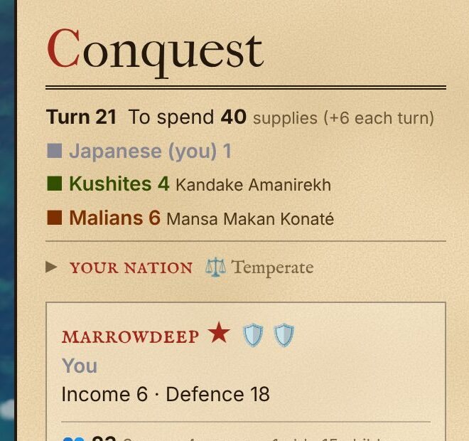

Playing the Japanese, "Japanese (you)" and "You" on the panel are a pale grey-lilac on parchment. Playing the Japanese
against the Franks and the Kushites, both rivals were green; playing the Franks, the Malians and the English were a brown
and a red hard to tell apart. On the 3D map the shields are the only mark of whose a land is, so two rivals in one colour read as one.

### 9. A Japanese town builds a Church, and decrees "Call them to church" (medium)

The building list and the decrees name the Church and show ⛪ whatever the people (see shot 7). The model on the map already
wears the people's own sign (a torii, a crescent, a flame), so only the words lag behind. The owner asked for it to feel
real; this is where it doesn't.

### 10. The tales come every fourth season, with three tall buttons in capitals (medium)

In both campaigns a tale came on seasons 3, 7, 11, 15 and 19, like a clock. Each is a dialog of three narrow buttons with the
whole price in small capitals ("SELL IT TO THEM, AT A HUNGRY MAN'S PRICE (+4 SUPPLIES, DECADENCE +12)"), hard to read
and harder to compare; *Let it settle itself* never says what it does. The stories met face to face (shot 12) read far better.

### 11. "of age in 43" (low)

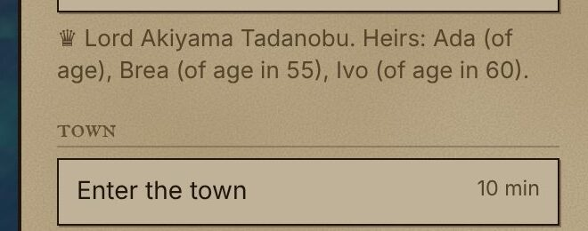

"Heirs: Ada (of age), Brea (of age in 55), Ivo (of age in 60)." The number is seasons from now, but reads as an age.

### 12. Small numbers that read as nonsense (low)

"Raiders, the Ash Riders, came against Riverbend with a strength of 0.9 … the town defended itself with its men (0.9), its
fortress and barracks (0.5), the army there (11), the capital's guard (1): 13.4 in all." Strengths with tenths, and a band of
0.9 called raiders.

## What's never seen

Over 40 seasons in two campaigns, played the way a new player would (one land, building and decreeing):

### 13. The encounter window never opened by itself (high)

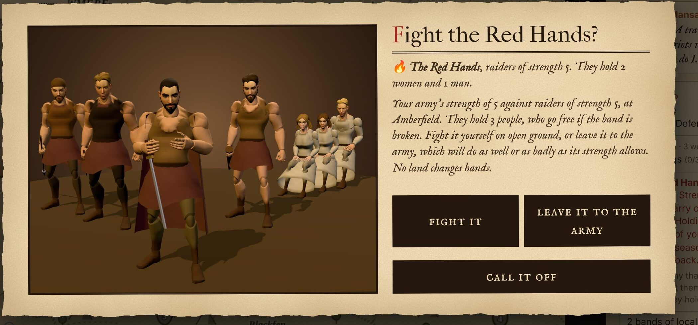

The four stories met face to face need a thief **caught** (a watch set, or many seasons), a **grown** daughter (the heirs
come of age in 40 to 60 seasons), a spouse and a rival who hates the player, or nobles angry enough to plot. None of that
happened in 40 seasons. A band is met face to face only when the player sends an army at it from the band's own land; the
bands that came against the player's towns (six times) were settled on the map without a window. So the system the owner
asked for on 16 November is, for most players, never seen in their first hours. It works when it comes: every story's window
answered rightly (thief set to work, suitor wed, envoy defied, plotter pardoned), with no errors.

### 14. Most of the new town buildings and the studies stay locked for a passive player (medium)

The Infirmary, Hall of Judgement, Noble's Manor, Monastery, Watch House and Inn, and every study, ask for a later age. The
Japanese player who raised a company each season never saved the 20 supplies for the Bronze Age and saw none of them in 20
seasons. The Franks' player who saved for it reached the Bronze Age in season 6 and then raised the Infirmary (season 9),
the Watch House (10), the Inn (11) and the Hall of Judgement (12), and learned Kinship, Crop Rotation, Salting and Smoking and
Stewardship; the Noble's Manor, the Monastery and eleven studies were still locked in the Iron Age at season 20. Nothing on
the panel says *save for the age to open these*.

### 15. Convoys, roads, harbours, diplomacy, marriage (medium)

With one land there is no convoy button and no road; no rival offered or asked for a truce in 40 seasons; the harbour stayed a
button. Each is there, but only for a player who goes looking.

## What worked

- Buy grain abroad: given in eight seasons out of twenty (it can be given every other season), each time "50 food for 50 gold" into the town's stores, and the log
  says so.
- The Granary, Mill and Well rose over the next seasons, each with its own line in the log, from the town's own stores; for
  the Franks, after the Bronze Age, the Infirmary, Watch House, Inn and Hall of Judgement as well.
- Studies: four learned by the Franks, one a season, each from the panel.
- Advancing the age from the panel, twice (Bronze in season 6, Iron in season 19).
- A field battle in person, both nations: from the map to the battle and back, the land changing hands, the leader's word on
  the panel.
- A town visit, both nations: in, a villager chosen, out, back on the map.
- The thief, the suitor (including *Ask Elin what she wants*), the envoy and the plotter, each in its window, each answer
  carried out; the killer stayed on the land's panel with its accusations, as meant.
- The band's window, with its men and those it holds. One fix made here, in my own file: the third of the band's captives
  sat outside the right edge of the picture; `src/client/encounter.ts` now seats them further back and closer together, and
  all three show (shot 13, second picture).

## Fixed since

The fixes handed back to this session, each with a 2× screenshot:

- **1, the build menu** (`fixed-build-menu.jpg`): the villager's menu is in pages of at most 13 (Settlement 1 of 2,
  Settlement 2 of 2, Military), **V** turns the page and **B** is Stop, as on every unit's card; no key is ever printed as
  "undefined". The Granary, Mill, Well, Infirmary, Watch House, Fortress and Inn have drawn icons
  (`scripts/civic-icons.mjs`, which writes `public/assets/icons/*.svg`); a painted `.webp` of the same name replaces any.
- **4, First Orders** (`fixed-first-orders.jpg`, `fixed-band-strength.jpg`): hidden while a dialog, a meeting or the
  season's card is open; raising a town building counts as building on the land; the last step is *Outlast them*.
- **7, the panel's groups** (`fixed-panel-groups.jpg`): *Raise troops*, *Raise in this town* (with each price in the
  town's stores), *Study*, *Build on the land* (in supplies, with how many sites stand), each under a line saying who pays.
- **8, colours** (`fixed-colours.jpg`): the Japanese wear indigo; no two peoples of one world wear colours too alike
  (`src/sim/nationcolours.ts`). Campaigns begun before this keep the colours they were dealt.
- **9, the house of faith** (`fixed-decrees.jpg`): a Shrine, a Mosque, a Temple, a Fire Temple or a Church by the people's
  sign, in the panel and the decrees (`src/sim/faithhouse.ts`).
- **11, heirs** (`fixed-heirs.jpg`): "of age in 2 years".
- **12, strengths** (`fixed-band-strength.jpg`): "a strength of 5 (strong)"; a raid's report gives whole numbers and says
  "about" when the rounded parts would not add up.

# Second pass, 17 November 2026 (main at 0283c7a)

The same play as the first pass, on today's main: the Japanese and then the Franks for 20 seasons each, kept as dealt,
the driver answering what is put to it, raising the next town building, learning a study, giving decrees (Buy grain
abroad first), raising a company every fourth season and advancing the age when it can. In this pass it also sent
settlers whenever an empty land was offered, and made a deal with a noble every third season. A field battle in person and
a town visit for the Franks; an empty wild land beside the capital looked at and marched on; and, because neither campaign
ever offered settlers, a save with an empty land beside the capital, to send settlers there and see the town founded.

No errors reached the console in any of it. The page did not die in 40 seasons (the heap stayed at 47–89 MB).

## What the first pass found that is now right

- **The build menu** (finding 1): three pages, no "undefined", V and B in their places, also inside a town visit
  (`playtest2-build-menu.jpg`).
- **The battle's briefing and end card** (2, 3): a field battle says who you lead and against whom, what winning means and
  what follows; the card counts both sides, kind by kind, and names the fallen (`playtest2-briefing.jpg`,
  `playtest2-end-card.jpg`). The visit's own briefing says who lives there and that nothing is won or lost
  (`playtest2-visit.jpg`).
- **First Orders** (4): out of the way of every window met in 40 seasons.
- **"among the Kushites"** (5): "The people of Thistledown now count themselves among the English."
- **The tales** (10): seasons 5, 9, 13, 16, 19 and 21 for the Japanese; 4, 8, 12, 16, 18, 20 for the Franks. No longer
  a clock. Each answer in plain case with its price beneath, and *Let it settle itself* says what it does.
- **Met face to face** (13): a rival's envoy came for the Japanese in season 8, a suitor for the Franks' daughter in
  season 14, both by themselves.
- **What the next age opens** (14): the panel names the buildings and studies and what to save
  (`playtest2-next-age.jpg`). The Franks saved and advanced twice; the Japanese once.
- **Buy grain abroad**: given seven times by the Japanese and five by the Franks, each time "50 food for 50 gold".
- **The colours and the house of faith** (8, 9): the Japanese in indigo, a Shrine, "Call them to the shrine".

## What's broken

### 2.1 A story's window opens on top of the season's card (medium)

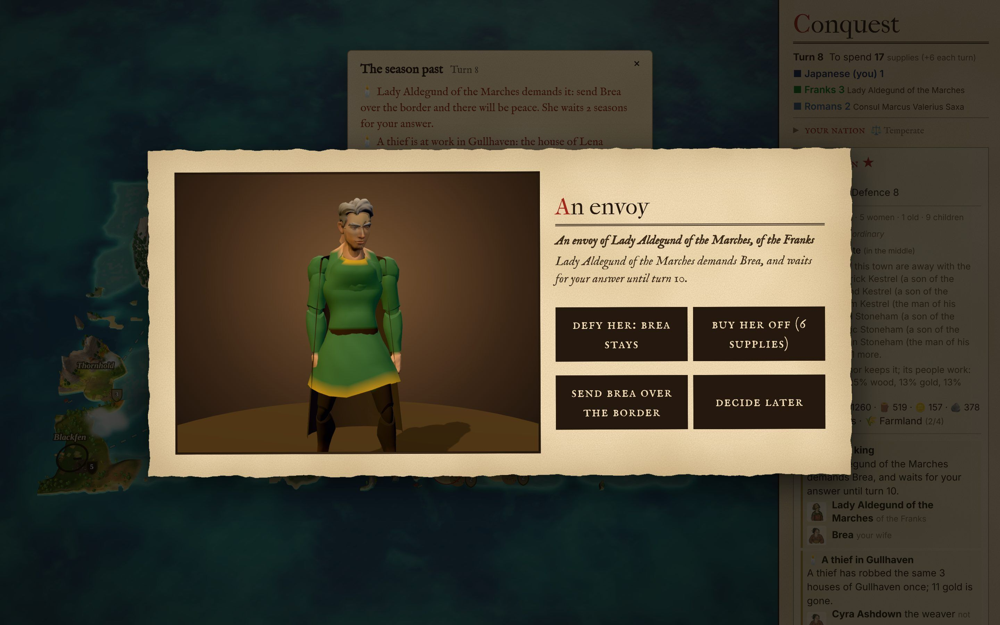

When a story comes to the leader's word in a season that also has news, the encounter window and the season's card are open
together, the card's first lines showing above the window. One should wait for the other.

### 2.2 True wilderness reads as a tribe's land you can march on (medium)

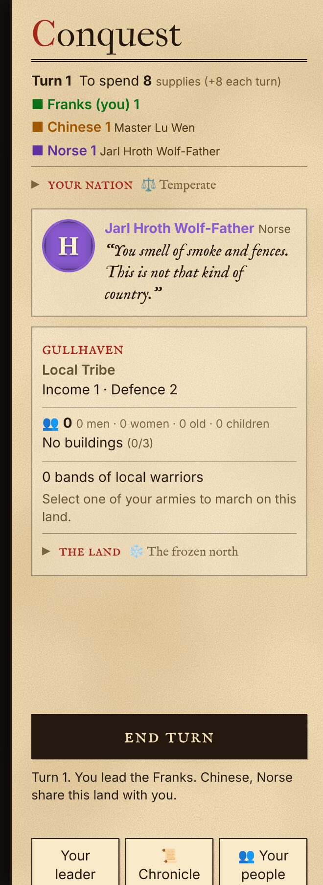

Gullhaven, near the Franks' capital in a new world, is the frozen north: nobody can settle it or take it. Its panel says "Local Tribe,
Income 1 · Defence 2, 0 bands of local warriors, Select one of your armies to march on this land". Marching the army
there does nothing, and nothing says why. It should say it is wilderness, and what that means.

### 2.3 The settlers' button names source files (low)

Its tooltip: "… to found a town on an empty land beside your own (migration.ts, founding.ts). They are not one of your
convoys." (`src/client/convoypanel.ts:12`).

### 2.4 The end card names a tribe's fallen as the player's own people (low)

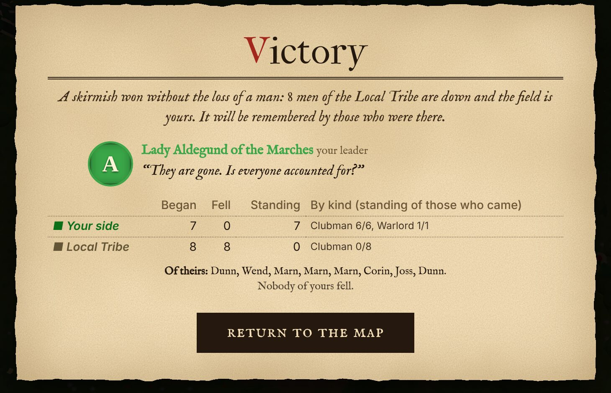

"Of theirs: Dunn, Wend, Marn, Marn, Marn, Corin, Joss, Dunn." Three Marns and two Dunns among eight men of a local tribe,
with the names of the player's own towns.

## What's confusing

### 2.5 A town is founded without a word (medium)

Settlers sent from Larkfield ("7 settlers have set out … they will be there next season") arrived and made Thornhold the
player's, but the season's card and the log said nothing of it; it is in the chronicle only. The first the player hears is
"Food is short at Thornhold: the governor has sent more of its people to the fields."

### 2.6 Dealing with nobles is a wall of buttons (medium)

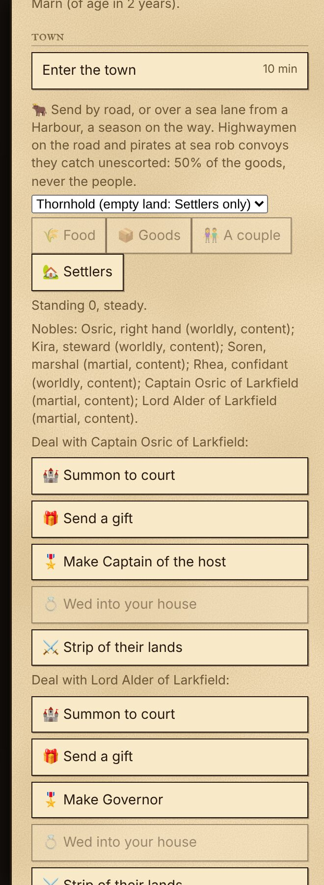

Each noble outside the leader's circle gets five buttons under *Town*: two nobles make ten, between the convoys and the
decrees. *Strip of their lands* (fear, anger, 150 gold seized) is one click beside *Send a gift*, with no asking. A captain
is offered "Make Captain of the host". The deals say what they cost but not what they do: after a gift the only word is
"Gifts are sent to Captain Osric of Larkfield", and the change shows only as *content* turning *pleased* in the Nobles line.

### 2.7 The tales' answers stand in tall narrow columns (low)

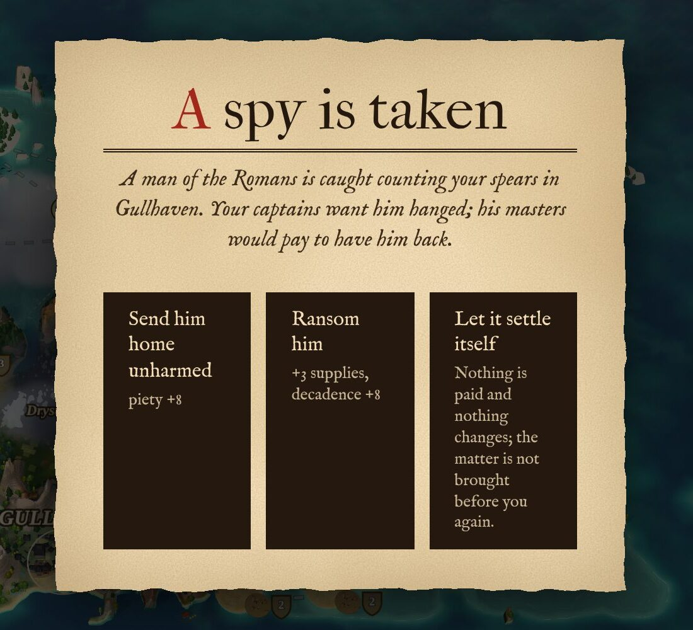

The plain case reads far better than before, but the three answers stand side by side in narrow boxes: *Let it settle
itself* and its explanation run to seven lines. One answer to a row would read at a glance.

### 2.8 A field battle still shows the town's bar (low)

The top bar of a field battle shows food, wood, gold and stone and a red "8/0" for people, where the briefing says nothing is
gathered or built (`playtest2-end-card.jpg`, top left).

## What's never seen

### 2.9 Settlers and founding (high)

In 40 seasons neither the Japanese nor the Franks were ever offered settlers: no land beside a one-land people was empty
and settleable (the convoy part of the panel, where settlers are sent, never appeared in either capital; the one empty land
looked at near a capital was true wilderness). From a save with an empty land
beside the capital it all works: the land is offered as "Thornhold (empty land: Settlers only)", the settlers set out with
food and timber, the land is the player's the next season with the seven of them, and its town is laid the season after.
A player who never takes land will not meet it; one who does may, when a tribe dies out. Nothing tells them it exists.

### 2.10 Nobles to deal with, for a small nation (medium)

The Japanese had nobles listed all 20 seasons (the right hand, the steward, the marshal, the confidant), and no deal with
any of them was ever offered: deals are only with captains, matrons and lords, and the Japanese capital never had a veteran,
a mother of note or twelve grown people at once. The Franks had a lord from season 3 and a captain from season 9, and the
deals worked (summoned three times, two gifts). For the Japanese the Nobles line is a list with nothing to do.

### 2.11 Bands that march on the player, face to face (medium)

Slavers came against both capitals (the Iron Market at Gullhaven; the Iron Market and the Tally-keepers at Dunmarrow) and
were beaten back, each settled on the map with a line in the log and no window. None was seen coming: the "seen on the
march" lines were all other peoples' ("The people at Windscar have seen the Tally-keepers on the march"), and no band fell
on the player's army. The encounter window opens only when the player sends an army at a band, or a band falls on one of
their armies; the threats session's change for a band coming for a town (4400e4b) reached main after this pass began.

Tried afterwards on today's main, from the save with a raiding band beside the army: once the four stories were put aside,
"The Red Hands have Amberfield for their mark" opened by itself, with the band's men and its captives, and three answers
(go out and fight them, send the army, let them come). It reads well. Two small things: it gives the strength as a bare
number ("raiders of strength 5") where the other band windows now say "a strength of 5 (strong)", and it gives the band's
strength twice in four lines.

### 2.12 Migration (low)

No family moved of its own accord, as expected: with one town there is nowhere of their own people to go.
